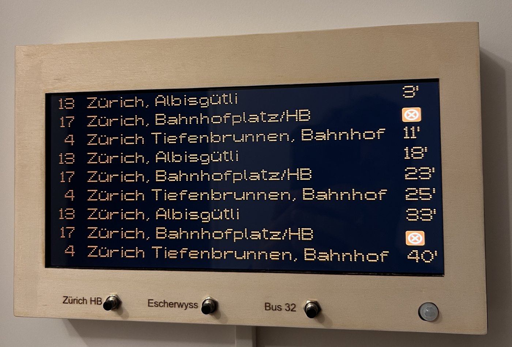
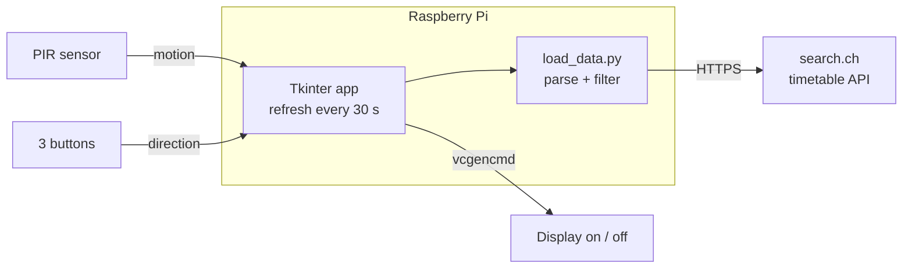

<div align="center">

# Departure Board

**A wall-mounted live departure board for the tram stop around the corner, in a hand-made wooden case.**

Raspberry Pi, a wide display, three hardware buttons and a motion sensor, in a laser-cut case with engraved labels.




</div>

---

## About

Leaving the flat a minute too late means watching the tram drive off. This board hangs next to the front door and shows the next departures at a glance, styled after the dot-matrix displays at Swiss tram stops.

It is a complete small hardware product: software on a Raspberry Pi, a display, physical buttons and a motion sensor, all in a case I designed, cut and engraved with a CNC laser cutter.

## Features

- **Live departures** of the tram stop, refreshed every 30 seconds, with real-time **delays** included in the minutes
- **Three direction buttons** on the case: *Zürich HB*, *Escherwyss* and *Bus 32*. Each switches the board to the departures that matter for that destination.
- **Cancelled services** are marked with a cancellation icon instead of a time
- **Motion-activated:** the screen turns on when someone walks by and switches off when nobody is around
- **Night mode:** the display stays off between 00:30 and 07:00
- **Authentic look:** orange dot-matrix font on a dark background, at most 9 rows, departures within the next 99 minutes

## Hardware

| Part | Purpose |
|---|---|
| Raspberry Pi | Runs the app, drives the display, reads the GPIO inputs |
| Wide-format display | Shows the departure board in fullscreen |
| 3 × momentary push buttons | Select the direction (GPIO, rising edge) |
| PIR motion sensor | Turns the screen on and off |
| Case | 3 mm plywood, cut and engraved with a CNC laser |

Wiring, pin assignment and the case are described in the [documentation](docs/DOCUMENTATION.md#hardware).

## How it works



1. Every 30 seconds the app checks the time and the motion sensor. Outside night mode and with someone in front of it, the screen turns on and new data is loaded.
2. `load_data.py` fetches the next 30 departures from the search.ch stationboard API, including delays and the following stops.
3. Departures are filtered by direction, using the **next stop** or the **line number**, adjusted by the delay, and sorted.
4. The Tkinter UI renders them in fullscreen with the dot-matrix font. Cancelled trips get an SVG icon, rendered with CairoSVG.

### Engineering highlights

| Area | Approach |
|---|---|
| **Direction filtering** | The API returns all departures of the stop. Directions are derived from the *next stop* (e.g. trams towards the main station pass *Museum für Gestaltung*) or from the line number for the bus. |
| **Real-time data** | Delays (`dep_delay`) are added to the scheduled time, and cancellations (`X`) are detected and shown as such. |
| **API migration** | The board started on the ZVV departure API. When I switched to search.ch, the new response was mapped to the same internal format, so the UI didn't change. |
| **Power and screen life** | The display is only on when the PIR sensor sees motion and never at night. The screen is switched with `vcgencmd display_power`, and the mouse cursor is hidden with `unclutter`. |
| **Input handling** | Buttons and sensor use GPIO interrupts (`add_event_detect`) with internal pull-downs. Button presses are locked for 2 s and sensor triggers for 30 s, so contact bounce and repeated triggers don't flood the API. |
| **Resilience** | Errors while updating are logged to `logfile.txt`. The next refresh is always scheduled, so a network or API outage only skips one cycle and the board recovers by itself. |
| **Hardware design** | Case and engraved labels were designed for and cut on a CNC laser from 3 mm plywood. |

## Tech stack

| Layer | Technology |
|---|---|
| **App** | Python 3, Tkinter, Requests |
| **Rendering** | Custom dot-matrix font, Pillow, CairoSVG |
| **Hardware** | Raspberry Pi, RPi.GPIO, PIR sensor, push buttons |
| **Data** | [search.ch timetable API](https://search.ch/timetable/api/help) |
| **Case** | CNC laser cutter, 3 mm plywood |

## Project structure

```
departureBoard/
├── gui_button_and_sensor.py   # Main app on the Pi: UI, GPIO, motion sensor, night mode
├── load_data.py               # search.ch client, parsing and direction filters
├── tkinterGUI_mac.py          # Preview of the UI on a Mac, without GPIO
├── cancellation.svg           # Icon for cancelled departures
├── requirements.txt
└── docs/
    ├── DOCUMENTATION.md       # Hardware, wiring, setup and configuration
    └── images/
```

## Getting started

```bash
pip install -r requirements.txt
python3 load_data.py               # prints the next departures for one direction
python3 tkinterGUI_mac.py          # UI preview on a Mac
python3 gui_button_and_sensor.py   # on the Raspberry Pi
```

See the [documentation](docs/DOCUMENTATION.md) for the Raspberry Pi setup, wiring and how to adapt the board to another stop.

---

<div align="center">
Built by <a href="https://github.com/severingoddon">Severin Goddon</a>
</div>
